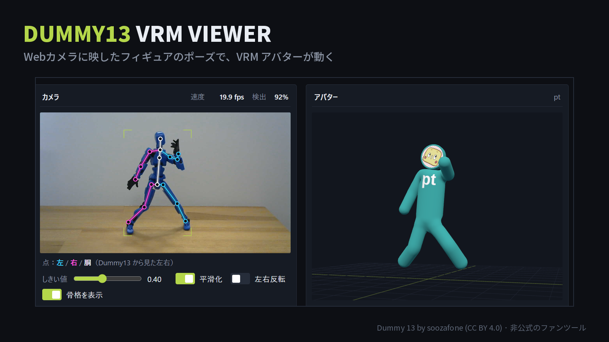

# Dummy13 VRM Viewer

[日本語](#日本語) | [English](#english)

> **Unofficial fan tool.** This project is not made, endorsed or supported by soozafone / Lucky 13 Toys (the creator of Dummy 13) or by VRChat Inc.
> **非公式のファンツールです。** Dummy 13 の作者（soozafone / Lucky 13 Toys）や VRChat の公式ツールではありません。

### ▶ 使ってみる / Try it: https://pt-da-yooon.github.io/dummy13-vrm-viewer/

説明 / About（日本語）：[ProtoPedia](https://protopedia.net/prototype/10032) · [YouTube](https://www.youtube.com/watch?v=VyDbEDj0Njs)



---

## 日本語

Webカメラに映した **Dummy 13**（3D プリントの可動フィギュア）のポーズを読み取って、VRM のアバターを同じポーズで動かすツールです。
Dummy 13 を「デッサン人形のようなポーズ入力コントローラー」として使うイメージです。

- **ローカルのみで処理・外部への送信無し**：推定はあなたの PC・スマホのブラウザの中だけで行います。映像はどこにも送られず、学習にも使われません。
- **Dummy 13 専用のモデル**：人間用の既製モデルではなく、Dummy 13 の 3D データから作った合成画像と実物の写真で独自に学習した YOLO-pose モデルです。
- **VRM アバターに対応**：VRM 0.x / 1.0 を読み込んで動かせます（読み込んだファイルもブラウザの外には出ません）。
- **オフラインでも動く**：一度開けば、インターネットにつながっていなくても使えます。
- **日本語 / English**：画面右上の JP / EN で切り替えられます。
- **アバターを配布中**：作者が自作した VRM アバター「pt」「panda-san」を、どなたでも自由に使えます（商用・改変・再配布 OK、クレジット表記も不要）。ダウンロード：[pt.vrm](https://github.com/pt-da-yooon/dummy13-vrm-viewer/raw/main/web/avatars/pt.vrm) / [panda-san.vrm](https://github.com/pt-da-yooon/dummy13-vrm-viewer/raw/main/web/avatars/panda-san.vrm)（[利用条件](web/avatars/README.md)）

### 使い方

**https://pt-da-yooon.github.io/dummy13-vrm-viewer/** を開いて、「カメラ開始」を押すだけです。インストールは要りません。

1. Dummy 13 をカメラに映す（全身が入るように）。
2. 右側のアバターが同じポーズで動きます。「VRM を読み込む」で自分の VRM アバターに差し替えられます。
3. 写真や動画ファイルで試すこともできます（「画像・動画で試す」）。

- PC（Chrome / Edge 推奨）でもスマホでも使えます。WebGPU が使えるブラウザでは GPU、それ以外は CPU で動きます。
- 初回はモデル（数十 MB）の読み込みに少し時間がかかります。
- 詳しい画面の説明は [web/README.md](web/README.md) を見てください。

#### 手元で動かす（開発者向け）

```bash
git clone https://github.com/pt-da-yooon/dummy13-vrm-viewer.git
cd dummy13-vrm-viewer/web
python -m http.server 8000
```

http://localhost:8000 を開きます。学習済みモデルは `web/models/` に同梱しているので、そのまま動きます。自分で学習したモデルに差し替えることもできます。

### 自分で学習する

1. [Printables の Dummy 13 version 1.0](https://www.printables.com/model/981111-dummy-13-version-10) から STL をダウンロードして `assets/dummy13/` に置く（[assets/dummy13/README.md](assets/dummy13/README.md)）。
2. Blender で合成データを作る（[synth/README.md](synth/README.md)）。
3. YOLO-pose を学習して、ブラウザ用に書き出す（[docs/gpu_pc.md](docs/gpu_pc.md)、`train/`）。
4. 実物の写真を点付けツール（`web/label.html`）でラベル付けして混ぜると、実物での精度が大きく上がります。

### フォルダ構成

| フォルダ | 内容 |
|---|---|
| `web/` | ブラウザ版（推定・3D アバター表示・点付けツール） |
| `synth/` | Blender による合成データ生成（STL の組み立て・リグ・ポーズ・レンダリング・背景合成） |
| `train/` | 学習・評価・ブラウザ用への書き出し |
| `configs/` | キーポイント（関節の点）の定義 |
| `infer/` | Python でのカメラ推論（試作） |
| `osc/` | VRChat への OSC 送信（試作。VRChat 連携は今後の予定） |
| `assets/dummy13/` | Dummy 13 の STL を置く場所（同梱していません） |

### ライセンスとクレジット

- Copyright (C) 2026 pt。このリポジトリのコード：**GNU AGPL-3.0**（[LICENSE](LICENSE)）。学習に Ultralytics YOLO（AGPL-3.0）を使っているためです。
- 学習済みモデル（`web/models/`）：**GNU AGPL-3.0**。Dummy 13 の STL（CC BY 4.0）から作った合成画像と、実物のフィギュアの写真で学習しています。
- クレジットの一覧：[CREDITS.md](CREDITS.md)
- **Dummy 13** by [soozafone](https://www.printables.com/model/981111-dummy-13-version-10)（Lucky 13 Toys）、**CC BY 4.0**。
  合成データの生成には無料配布の STL（CC BY 4.0）だけを使っています。STL はこのリポジトリには含めていません。
- 使用しているライブラリ：[Ultralytics YOLO](https://github.com/ultralytics/ultralytics)（AGPL-3.0）、
  [ONNX Runtime Web](https://github.com/microsoft/onnxruntime)（MIT）、[three.js](https://github.com/mrdoob/three.js)（MIT）、
  [three-vrm](https://github.com/pixiv/three-vrm)（MIT）、[Blender](https://www.blender.org/)（GPL）、見出しのフォント [Noto Sans JP](https://fonts.google.com/noto/specimen/Noto+Sans+JP)（SIL OFL 1.1、英数字だけに絞って同梱）、
  背景素材は [Poly Haven](https://polyhaven.com/)（CC0、各自ダウンロード）。
- `web/avatars/` の VRM アバター（pt・panda-san）は作者の自作で、[VRM Public License 1.0](https://vrm.dev/licenses/1.0/) の条件で配布しています（[利用条件](web/avatars/README.md)）。ほかの VRM アバターは、各アバターの利用条件に従って使ってください。

---

## English

A tool that reads the pose of a **Dummy 13** (a 3D-printed action figure) from your webcam and poses a VRM avatar the same way.
Think of Dummy 13 as a posable "mannequin controller" for your avatar.

- **Runs locally, nothing is uploaded**: inference runs entirely in your browser on your PC or phone. The camera feed is never sent anywhere and is never used for training.
- **A model made for Dummy 13**: not an off-the-shelf human pose model, but a YOLO-pose model trained on synthetic renders made from the Dummy 13 3D files plus photos of a real figure.
- **VRM avatars**: load a VRM 0.x / 1.0 file and it follows the figure (the file never leaves your browser either).
- **Works offline**: once the page has been opened, it keeps working without an internet connection.
- **Japanese / English**: switch with JP / EN at the top right.
- **Free avatars**: the author's own VRM avatars "pt" and "panda-san" are free for anyone to use (commercial use, modification and redistribution allowed; no credit required). Download: [pt.vrm](https://github.com/pt-da-yooon/dummy13-vrm-viewer/raw/main/web/avatars/pt.vrm) / [panda-san.vrm](https://github.com/pt-da-yooon/dummy13-vrm-viewer/raw/main/web/avatars/panda-san.vrm) ([terms](web/avatars/README.md))

### How to use

Open **https://pt-da-yooon.github.io/dummy13-vrm-viewer/** and press "カメラ開始" (Start camera). Nothing to install.

1. Show your Dummy 13 to the camera (the whole figure in view).
2. The avatar on the right follows the same pose. Use "VRM を読み込む" (Load VRM) to use your own VRM avatar.
3. You can also try it with a photo or video file ("画像・動画で試す").

- Works on PC (Chrome / Edge recommended) and on phones. Uses the GPU via WebGPU when available, otherwise the CPU.
- The first load takes a moment while the model (tens of MB) downloads.
- The UI is in Japanese for now. See [web/README.md](web/README.md) (Japanese) for details.

#### Run it locally (for developers)

```bash
git clone https://github.com/pt-da-yooon/dummy13-vrm-viewer.git
cd dummy13-vrm-viewer/web
python -m http.server 8000
```

Open http://localhost:8000. The trained models are included in `web/models/`, so it works out of the box. You can also replace them with models you train yourself.

### Training your own model

1. Download the STL files of [Dummy 13 version 1.0 on Printables](https://www.printables.com/model/981111-dummy-13-version-10) into `assets/dummy13/` ([assets/dummy13/README.md](assets/dummy13/README.md)).
2. Generate synthetic data with Blender ([synth/README.md](synth/README.md)).
3. Train YOLO-pose and export it for the browser ([docs/gpu_pc.md](docs/gpu_pc.md), `train/`).
4. Labeling real photos with the labeling tool (`web/label.html`) and mixing them in greatly improves accuracy on the real figure.

Most of the documentation inside the folders is in Japanese.

### License and credits

- Copyright (C) 2026 pt. Code in this repository: **GNU AGPL-3.0** ([LICENSE](LICENSE)), because it uses Ultralytics YOLO (AGPL-3.0) for training.
- Trained models (`web/models/`): **GNU AGPL-3.0**. Trained on synthetic images rendered from the Dummy 13 STL files (CC BY 4.0) and photos of real figures.
- Full credits: [CREDITS.md](CREDITS.md)
- **Dummy 13** by [soozafone](https://www.printables.com/model/981111-dummy-13-version-10) (Lucky 13 Toys), **CC BY 4.0**.
  Only the free STL files (CC BY 4.0) were used to generate the synthetic data. The STL files are not included in this repository.
- Libraries: [Ultralytics YOLO](https://github.com/ultralytics/ultralytics) (AGPL-3.0),
  [ONNX Runtime Web](https://github.com/microsoft/onnxruntime) (MIT), [three.js](https://github.com/mrdoob/three.js) (MIT),
  [three-vrm](https://github.com/pixiv/three-vrm) (MIT), [Blender](https://www.blender.org/) (GPL), the heading font [Noto Sans JP](https://fonts.google.com/noto/specimen/Noto+Sans+JP) (SIL OFL 1.1, a Latin-only subset is included);
  background assets from [Poly Haven](https://polyhaven.com/) (CC0, downloaded by each user).
- The VRM avatars in `web/avatars/` (pt, panda-san) are made by the author and distributed under the [VRM Public License 1.0](https://vrm.dev/licenses/1.0/) terms ([terms](web/avatars/README.md)). Use any other VRM avatar according to its own terms.
