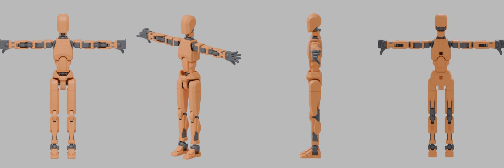

# synth/ — Blender 合成データ生成

```
assets/dummy13/*.stl（CC BY 4.0）
  → build_rig.py  STL を自動で組み立て、ボーンに親子付けしたリグ入り .blend を作る
models/dummy13_rig.blend（リグ入り）
  → generate.py   ポーズ・カメラ・照明・材質をランダム化して透過レンダリング + ラベル自動生成
  → composite.py  背景合成・Webカメラ風の劣化 → YOLO-pose データセット
  → preview.py    ラベルを描画して目視確認
```

## 1. リグ入り .blend を作る（自動）

```bash
python synth/build_rig.py                 # → models/dummy13_rig.blend（pip の bpy、または blender -b -P ... --）
python synth/build_rig.py --hands fist    # 手の形（open / fist / grip）
python synth/build_rig.py --no-armor      # フレームだけ
```



- 配置は `dummy13_layout.py` が計算する。フレームは STL を実測した関節位置（半径 3mm のボール・ソケット、
  ヒンジピン）から、アーマーは「フレームを包み、めり込まない位置」を自動探索した結果を、組み立てガイドと照合して決めた。
- 膝・肘は二重ヒンジ（軸間 6mm）なので、ヒンジ部品にも短いボーン（`knee.*` / `elbow.*`）がある。
- ボーンのローカル X 軸は「+ で前に曲がる」向き。足は足首の前後軸まわりに左右へ傾く（ローカル Y）。
- 単位はメートル、足裏が Z=0、正面が -Y、Dummy13 の左手側が +X。
- 見た目は実物と見比べて確認済み。未確認なのは可動域。
  実物と見比べて違っていたら `dummy13_layout.py` の `ARMOR` を直す。

自作のリグを使う場合は、アーマチュアを1つ置き、ボーン名を `rig_config.json` と合わせればよい
（パーツはボーンに親子付けするか、アーマチュアモディファイア＋ウェイト）。

## 1.5 可動域を自動で求める

```bash
python synth/estimate_limits.py           # 結果を表示
python synth/estimate_limits.py --write   # rig_config.json の joint_limits_deg を上書き
```

T ポーズから各ボーンを1軸ずつ 2.5° 刻みで回し、動く側の部品が動かない側にめり込み始める角度を上限にする
（T ポーズで既に接している分は差し引き、関節機構そのもの＝ボールとソケット・ピンとクリップの周りは判定から外す）。
1軸ずつしか調べないので、複数の関節を同時に曲げたときの干渉は generate.py 側で弾く（下記）。ボールジョイントのスイングは
ソケットの縁の当たりを判定から外しているため 90° で打ち切り、ねじり（Y）も 90° で打ち切る。

## 2. rig_config.json

| キー | 内容 |
|---|---|
| `armature` | アーマチュアのオブジェクト名 |
| `keypoints` | `configs/keypoints.yaml` の各点をどこに置くか。`{"bone": 名前, "at": "head" / "tail" / 0〜1}`（ボーン上の位置）または `{"object": 空オブジェクト名}` |
| `joint_limits_deg` | ボーンのローカル X/Y/Z 回転の範囲（度）。**実物の可動域に合わせて要調整**（軸の向きはリグ次第なので、Blender 上でボーンを回して確認する） |
| `neutral_prob` | 控えめなポーズ（範囲を 0.3 倍）にする確率 |
| `render.engine` | `EEVEE`（速い・GPU 必須）/ `CYCLES`（GPU が無い環境・サーバーでも動く） |
| `camera.fill` | 大きいほどフィギュアが小さく写る |
| `pose_gamma` | 1 より大きいと T ポーズ寄りの角度が出やすくなる（既定 2.0。全関節を同時に目いっぱい曲げるとほとんどめり込むため） |
| `collision` | ポーズ全体のめり込み検査。隣り合わないボーンの部品どうしで、頂点が相手の内側に `depth_mm` 以上入った数が T ポーズより `max_new_points` を超えて増えたら引き直す（最大 `max_tries` 回） |
| `occlusion_tolerance` | 関節点の手前にある表面との距離がフィギュアサイズ×この値以内なら「見えている」扱い |

## 3. 実行

```bash
# Blender 本体
blender -b models/dummy13_rig.blend -P synth/generate.py -- --count 1000
# pip の bpy モジュール（pip install bpy。Python のバージョンが bpy と合っている必要あり）
python synth/generate.py --blend models/dummy13_rig.blend --count 1000

# 並列に回すときは --start をずらす（同じ --seed なら番号ごとに再現性あり）
blender -b models/dummy13_rig.blend -P synth/generate.py -- --start 1000 --count 1000

python synth/download_backgrounds.py      # Poly Haven（CC0）から背景・照明用 HDRI を取得（初回のみ）
python synth/composite.py --per-image 3   # 背景は data/backgrounds/ 以下を自動で使う
python synth/preview.py data/synth/yolo/images/train
```

`--dry-run` でレンダリングせずラベルだけ出せるので、ボーン名の設定確認に使える。

出力:
- `data/synth/raw/labels/*.txt` — YOLO-pose 形式（`0 cx cy w h x y v ...`、v は 0=画面外 / 1=隠れ / 2=見える）
- `data/synth/raw/meta/*.json` — 関節角度（度）、カメラ座標系の3Dキーポイント（OpenCV 向き）、カメラ焦点距離など。
  3D化や関節角度の直接推定の学習に使う予定。
- `data/synth/yolo/dataset.yaml` — Ultralytics にそのまま渡せる（`flip_idx` は `keypoints.yaml` の `flip_pairs` から生成）

## 既知の制限・今後

- 背景合成なので床への影や接地感は無い。実写で微調整する前提。
- 背景は Poly Haven（CC0）のテクスチャと、屋内 HDRI から切り出した部屋の画像。自分の机まわりの写真を
  `data/backgrounds/` に足すとさらに実写に近づく。
- 屋内 HDRI はレンダリング時の照明にも使う（`light.hdri_prob` の確率。背景は透過なので HDRI 自体は写らない）。
- 動作確認は Blender 5.0（bpy モジュール、Cycles）で行った。EEVEE は GPU の無い環境では動かない。
